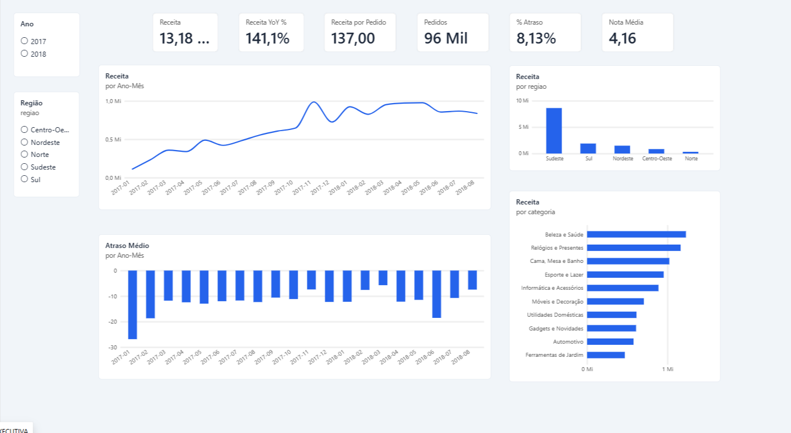
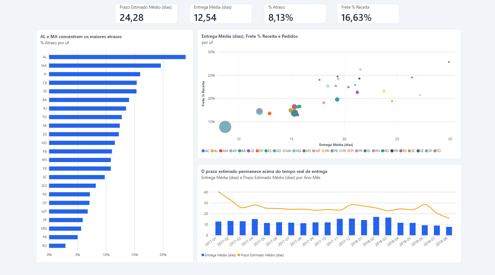
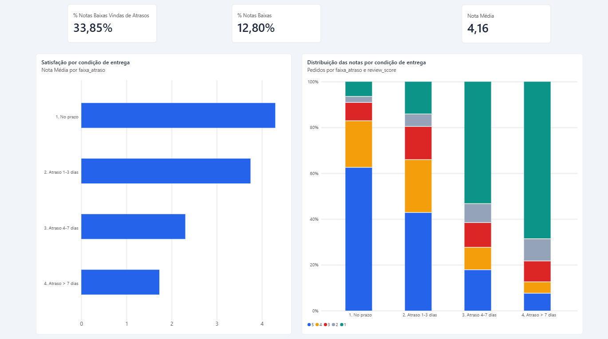
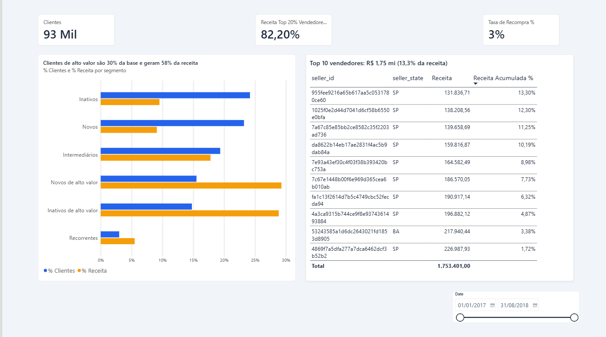

# Olist: vendas, logística e satisfação do cliente

Análise de ~100 mil pedidos reais de um marketplace brasileiro (2016–2018).
**Pergunta central:** o que afeta a receita e a experiência do cliente, e o que a empresa deveria fazer a respeito?

**Stack:** SQL (SQLite) · Python (pandas, scipy, scikit-learn, seaborn) · Power BI (dashboard de 4 páginas, medidas DAX) · Excel (resumo executivo)

## Principais achados
- A receita de jan–ago/2018 foi **141% maior** que a de jan–ago/2017, com ticket médio estável (~R$ 138): crescimento por volume.
- **Atraso é o principal fator de insatisfação:** nota média 4,29 no prazo vs 2,55 atrasado (Cliff's δ = −0,56). Só 8,1% dos pedidos entregues atrasam (7,9% entre os avaliados), mas geram **34% das notas 1–2**.
- O **Nordeste** concentra os maiores atrasos (AL 24%, MA 20%) e o frete mais pesado. No **Norte**, entre os estados com pelo menos 200 pedidos, PA e TO ficam em ~12% de atraso e RO em ~3%: o padrão não é uniforme.
- Os **20% maiores vendedores** respondem por ~82% da receita.
- **97% dos clientes compraram uma única vez**, e a baixa recompra não é explicada por atraso ou nota baixa.

Resumo executivo para gestores: [`excel/resumo_executivo_olist.xlsx`](excel/resumo_executivo_olist.xlsx) (KPIs, achados e recomendações priorizadas, tudo em fórmulas).

Análise completa e recomendações: [`notebooks/01_eda_olist.ipynb`](notebooks/01_eda_olist.ipynb)

## Modelo preditivo: risco de atraso na hora da compra
[`notebooks/02_modelo_atraso.ipynb`](notebooks/02_modelo_atraso.ipynb) — prevê se um pedido vai atrasar usando **só o que se sabe na compra** (sem vazamento), com validação temporal em 12 janelas móveis (set/2017 a ago/2018).

- **Sinalizando os 10% de pedidos de maior risco, o modelo captura ~27% dos atrasos** (lift de ~2,7x; ~22% dos sinalizados atrasam, contra ~9% na base).
- **O sinal vem da folga do prazo**: pedidos com prazo prometido menor ou igual ao tempo típico da rota atrasam **30%** das vezes; com folga acima de 15 dias, **4%**.
- **Simplicidade venceu:** regressão logística com 4 atributos (AUC médio 0,69; pior mês 0,62) superou o gradient boosting (0,65), que caiu abaixo do acaso quando a política de prazos mudou em ago/2018 (*concept drift*).
- **Desempenho moderado e probabilidades não calibradas**: serve para *triagem de risco*, não para garantias.

## Estrutura
```
├── carregar_banco.py          # CSVs -> SQLite + views
├── sql/
│   ├── 01_views.sql           # camada limpa (agrega antes de juntar)
│   └── 02_consultas_negocio.sql
├── exportar_powerbi.py        # gera os CSVs do modelo estrela para o Power BI
├── src/atraso.py              # atributos e avaliação do modelo (sem vazamento)
├── notebooks/
│   ├── 01_eda_olist.ipynb     # análise exploratória e recomendações
│   └── 02_modelo_atraso.ipynb # modelo de risco de atraso
├── powerbi/                   # roteiro (modelo + DAX), tema, modelo .pbit e prints/
│   └── prints/                # as 4 páginas do dashboard (PNG)
├── excel/resumo_executivo_olist.xlsx  # resumo executivo (10 abas, 409 fórmulas)
├── build_xlsx.py              # gera a planilha (requer olist.db e powerbi/dados/)
├── reports/figures/           # gráficos exportados
├── data/                      # CSVs do Kaggle (não versionados)
├── requirements.txt
├── LICENSE
└── .gitignore
```

## Como reproduzir
1. Baixe o dataset [Brazilian E-Commerce Public Dataset by Olist](https://www.kaggle.com/datasets/olistbr/brazilian-ecommerce) e extraia os CSVs em `data/`.
2. `pip install -r requirements.txt`
3. `python carregar_banco.py` (cria `olist.db`)
4. `python exportar_powerbi.py` (gera os CSVs do modelo estrela em `powerbi/dados/`)
5. Abra os notebooks em `notebooks/` (o 02 usa `src/atraso.py`).
6. Opcional: `python build_xlsx.py` regenera `excel/resumo_executivo_olist.xlsx`.

**Diretório de execução:** execute os scripts de terminal a partir da raiz do projeto (`projeto-olist/`). Os notebooks devem ser abertos/executados com o diretório de trabalho definido como `notebooks/`, pois usam caminhos relativos como `../olist.db` e `../src`. Se abrir os notebooks em outro diretório, ajuste o diretório de trabalho ou os caminhos antes de executar.

## Decisões metodológicas
- **Escopo:** pedidos `delivered`, compra entre jan/2017 e ago/2018 (meses completos).
- **Sem duplicar receita:** itens, pagamentos e reviews têm várias linhas por pedido; são agregados antes do JOIN (a receita da tabela fato bate com a bruta).
- **Reviews duplicadas:** mantida a mais recente por pedido.
- **Cliente** = `customer_unique_id` (o `customer_id` muda a cada pedido).
- **Frete como % da receita** calculado como razão de somas, não média de razões por pedido (esta seria inflada por pedidos baratos).
- **RFM adaptado:** com 97% de clientes de compra única, quintis de frequência não funcionam; recorrentes são separados e os demais segmentados por recência e valor.

## Dashboard Power BI
Modelo estrela (2 fatos, 4 dimensões e tabela de calendário) com medidas DAX, em 4 páginas. O passo a passo (modelo, medidas, páginas e valores de conferência) está em [`powerbi/roteiro_powerbi.md`](powerbi/roteiro_powerbi.md).

| Página | Pergunta | Print |
|---|---|---|
| Visão Executiva | Como está o negócio? | [`01_visao_executiva.png`](powerbi/prints/01_visao_executiva.png) |
| Logística | Onde e quanto a entrega falha? | [`02_logistica.png`](powerbi/prints/02_logistica.png) |
| Satisfação | O atraso derruba a nota? | [`03_satisfacao.png`](powerbi/prints/03_satisfacao.png) |
| Clientes e Vendedores | Quem compra e quem vende? | [`04_clientes_vendedores.png`](powerbi/prints/04_clientes_vendedores.png) |






O modelo `powerbi/olist_dashboard.pbit` não traz dados: ele lê os CSVs gerados por `exportar_powerbi.py`. Ao abrir, ajuste a pasta de origem em *Transformar dados → Configurações da fonte de dados*.

### Paleta de cores e nomes (iguais aos do dashboard)
Os gráficos do notebook, as figuras em `reports/figures/` e a planilha Excel usam a mesma paleta do tema `Olist Portfolio` (`powerbi/tema_olist.json`), na ordem em que o Power BI a aplica:

| Ordem | Cor | Uso no dashboard |
|---|---|---|
| 1 | `#2563eb` azul | Cor principal: barras, linhas e colunas de uma série só; `% Clientes`; nota 5 |
| 2 | `#f59e0b` âmbar | Segunda série: `% Receita`, linha do `Prazo Estimado Médio (dias)`; nota 4 |
| 3 | `#dc2626` vermelho | Terceira série; nota 3 |
| 4 | `#94a3b8` cinza-azulado | Quarta série; nota 2 |
| 5 | `#0d9488` verde-água | Quinta série; nota 1 |

No gráfico de dispersão da página Logística, cada UF recebe uma cor da paleta completa, na ordem alfabética (AC azul, AL âmbar, AM vermelho, AP cinza-azulado, BA verde-água, e assim por diante). Os nomes de métricas, páginas e faixas de atraso (`1. No prazo`, `2. Atraso 1-3 dias`, `3. Atraso 4-7 dias`, `4. Atraso > 7 dias`) também seguem os do Power BI.

Os cartões do dashboard conferem com os valores de referência impressos por `exportar_powerbi.py` (receita R$ 13,18 mi, 96.211 pedidos, 8,13% de atraso, nota 4,16, 82,2% da receita nos 20% maiores vendedores etc.).

**Por que alguns números do Power BI diferem do notebook:** (1) o ticket médio do notebook (R$ 138,09) é a *média dos tickets mensais*; no Power BI a medida `Receita por Pedido` é receita ÷ pedidos (R$ 137,00). (2) A parcela das notas 1–2 atribuída a pedidos atrasados é cerca de 33,8% no notebook e 33,9% no Power BI. As implementações não usam exatamente a mesma regra: o notebook classifica o atraso por `dias_atraso > 0` após arredondamento a uma casa decimal; a medida do Power BI usa `flag_atrasado`, baseada na comparação exata entre data/hora real e estimada. Além disso, existem **8 pedidos sem data de entrega** na base geral do notebook 02 (96.203 pedidos com data contra 96.211 pedidos no conjunto total). Confira a medida e o denominador efetivamente usados no visual antes de atribuir toda a diferença percentual a esses pedidos; não misture a regra de atraso com a regra de inclusão no denominador.

## Limitações
Análise observacional (associação, não causalidade); modelo treinado em apenas 20 meses, sujeito a mudança de política; sem dados de custo/margem (receita ≠ lucro); janela de 20 meses de uma empresa em crescimento acelerado; atraso medido contra a data estimada pela plataforma.

**Definição de atraso:** a data estimada do Olist vem à meia-noite (00:00) e a entrega tem horário, então um pedido entregue *no próprio dia prometido* conta como atrasado. São 1.139 dos 7.822 atrasos (15%), com nota média ~4,0 (comportam-se como pedidos no prazo). Se o atraso fosse contado só a partir de 1 dia, a taxa cairia de 8,1% para ~6,9% e a diferença de nota entre atrasados e no prazo ficaria ainda maior; a conclusão não muda, mas os percentuais absolutos sim. A mesma regra vale para o alvo do modelo de risco.

**Amostras por UF:** a consulta SQL e o notebook usam corte de pelo menos 200 pedidos por UF. O gráfico de barras de atraso por UF do dashboard aplica o mesmo corte (filtro de visual `Pedidos ≥ 200`), então estados com poucos pedidos (RR, AP, AM e AC) ficam fora dele, porque suas taxas são instáveis. Os cartões e os demais visuais consideram todos os pedidos.

## Dados e licença
Os dados são do [Brazilian E-Commerce Public Dataset by Olist](https://www.kaggle.com/datasets/olistbr/brazilian-ecommerce) (Kaggle), publicado sob CC BY-NC-SA 4.0 (confira a licença na página do dataset). Os CSVs brutos e os CSVs derivados não são versionados neste repositório. O arquivo `.pbix` também não está incluído nesta versão do repositório; para compartilhar o dashboard sem embutir os dados, prefira publicar um `.pbit` (modelo sem os dados importados) e manter os prints atualizados. Antes de distribuir qualquer arquivo com dados, confira as condições da licença CC BY-NC-SA 4.0 do dataset. O código deste projeto é distribuído sob a licença MIT (ver `LICENSE`); essa licença não substitui nem altera a licença dos dados. Projeto de portfólio, sem fins comerciais, sem vínculo com a Olist.

## Ambiente testado
Python 3.12 com pandas 3.0, NumPy 2.4, scikit-learn 1.8 (mínimo: scikit-learn 1.4, por causa de `categorical_features="from_dtype"`).
